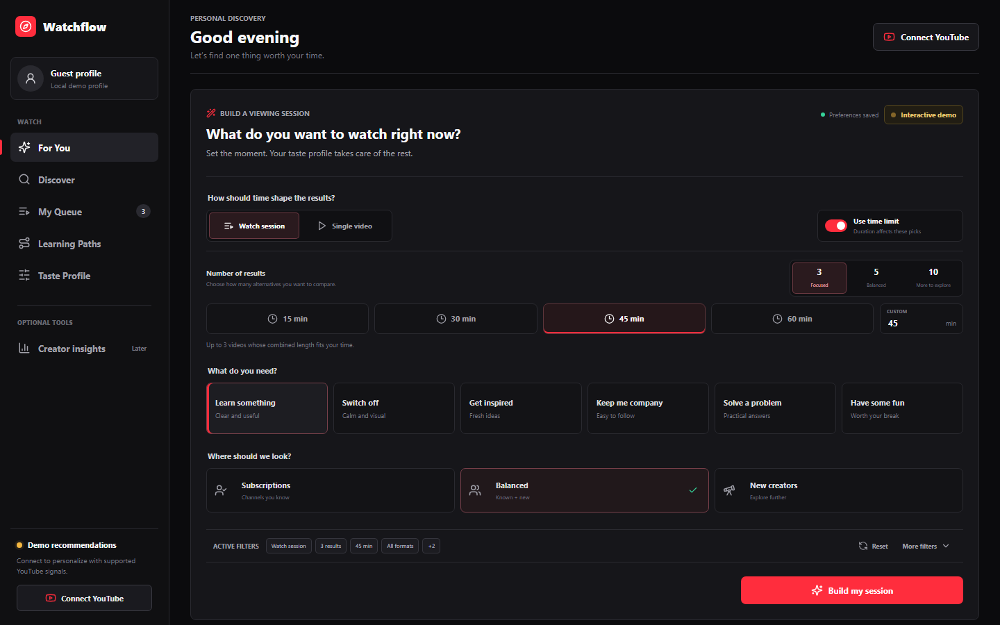
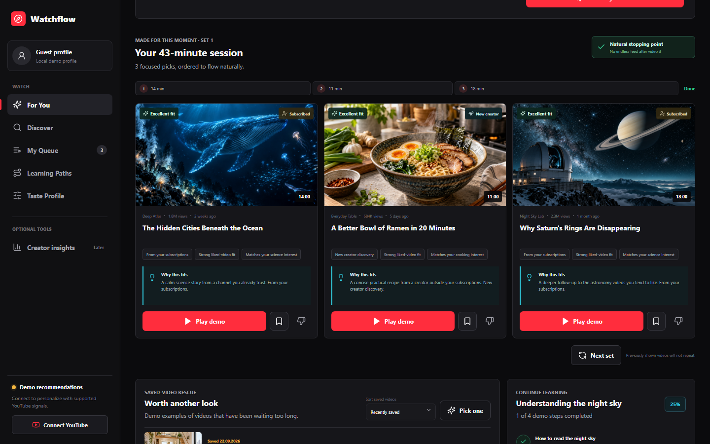
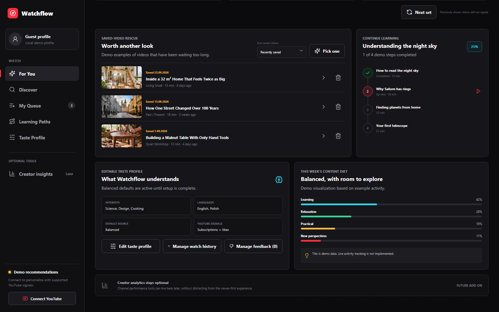

# Watchflow

Watchflow pomaga wybrać film na YouTube wtedy, gdy użytkownik wie, **ile ma czasu i czego w danym momencie potrzebuje**, ale nie chce kolejny raz przeglądać nieskończonego feedu. Aplikacja zamienia te informacje w krótki, wyjaśnialny zestaw rekomendacji: może ułożyć całą sesję oglądania albo pokazać kilka alternatyw jednego filmu.

To projekt skierowany do zwykłych widzów YouTube. Zamiast analizować rozwój kanału, skupia się na pytaniu: *co naprawdę warto teraz obejrzeć?*



## Jak korzysta się z aplikacji

Użytkownik może połączyć konto Google albo uruchomić tryb demonstracyjny bez konfiguracji zewnętrznych usług. Po zalogowaniu Watchflow synchronizuje dostępne sygnały YouTube, zapisuje profil smaku i przywraca ustawienia sesji na kolejnych urządzeniach.

Przed wygenerowaniem zestawu użytkownik określa:

- czy chce zbudować kilkufilmową sesję, czy znaleźć pojedynczy film;
- ile wyników chce porównać: 3, 5 lub 10;
- ile ma czasu albo czy długość nie ma znaczenia;
- czego teraz potrzebuje, na przykład nauki, relaksu, inspiracji lub rozrywki;
- czy wyniki mają pochodzić z subskrypcji, od nowych twórców czy z obu źródeł;
- temat, język, format oraz czas publikacji, w tym opcję `Newest` obok ścisłych zakresów wieku filmu.

Wybrane ustawienia są zapisywane. Użytkownik nie musi więc konfigurować wszystkiego od początku po każdym odświeżeniu strony.

## Skąd Watchflow bierze filmy

Watchflow nie pobiera jednego gotowego feedu rekomendacji z YouTube. Buduje własną pulę kandydatów z kilku kontrolowanych źródeł:

1. **Subskrypcje** - podczas synchronizacji aplikacja pobiera listę subskrybowanych kanałów i ich najnowsze materiały. Kanały często oglądane przez użytkownika otrzymują wyższy priorytet, ale zestaw nadal zachowuje różnorodność.
2. **Nowi twórcy** - aplikacja tworzy zapytania wyszukiwania na podstawie wybranego tematu oraz sygnałów gustu, a następnie odrzuca kanały już subskrybowane. W tej puli obowiązuje również próg popularności i jakości, żeby ograniczyć przypadkowe, mało wiarygodne wyniki.
3. **Polubione filmy** - nie są osobnym źródłem kandydatów. Służą jako sygnał mówiący, jakie tematy i kanały są dla użytkownika istotne.
4. **Historia oglądania** - YouTube Data API nie udostępnia historii. Użytkownik może dobrowolnie zaimportować plik `watch-history.json` z Google Takeout. Watchflow wykorzystuje znormalizowane wpisy do rozpoznawania często oglądanych twórców, tematów i powtarzających się zainteresowań.
5. **Aktywność w Watchflow** - zapisanie, otwarcie lub odrzucenie filmu wpływa na następne zestawy. Użytkownik może wskazać, że film już widział, nie interesuje go dany temat, materiał jest teraz za długi albo dany kanał pojawia się zbyt często.

Surowy plik Google Takeout jest odczytywany w przeglądarce. Do backendu trafiają tylko dane potrzebne do personalizacji, a korzystanie z historii można później wyłączyć w profilu.

## Jak powstaje rekomendacja

Po zbudowaniu puli Watchflow stosuje wymagane filtry, a następnie nadaje każdemu filmowi deterministyczny wynik. Ranking uwzględnia między innymi zgodność z wybranym tematem i intencją, historię oglądania, polubienia, relację z kanałem, długość, świeżość, popularność nowych twórców oraz wcześniejszy feedback. W kontroli `Published within` można wybrać ścisły zakres publikacji albo `Newest`. Ta ostatnia opcja pozostawia pozostałe filtry bez zmian, lecz ustawia najnowsze pasujące publikacje na początku; dla nowych twórców również wyszukuje YouTube według daty publikacji.

Filtry języka, formatu i wieku są ścisłe. Jeśli brakuje wystarczającej liczby pasujących filmów, aplikacja pokaże krótszy zestaw zamiast po cichu uzupełnić go starszymi lub niepasującymi materiałami. Na każdej karcie znajduje się krótka informacja **Why this fits**, dzięki której wiadomo, jakie sygnały wpłynęły na wybór.



### Czy sugerowane filmy kiedyś się kończą?

Tak, i jest to zamierzone. Watchflow nie tworzy nieskończonego feedu.

Każdy zestaw zawiera maksymalnie 3, 5 lub 10 filmów. Przycisk **Next set** wyklucza materiały pokazane wcześniej w tym samym łańcuchu, a także filmy oznaczone jako obejrzane lub odrzucone. Kolejne zestawy powstają do momentu wyczerpania aktualnej puli spełniającej wszystkie filtry.

Gdy nie ma już następnych dopasowań, użytkownik otrzymuje jasny stan końcowy. Może wtedy zmienić temat, rozszerzyć źródło, poluzować limit wieku lub czasu albo przeprowadzić nową synchronizację. Watchflow nie rozszerza tych ustawień samodzielnie i nie miesza danych demonstracyjnych z wynikami live.

## Kolejka, profil i kontrola rekomendacji

Film można zapisać do trwałej kolejki, otworzyć na YouTube albo odrzucić z konkretnym powodem. Kolejkę można sortować według daty zapisania, daty publikacji i długości materiału oraz usuwać z niej pojedyncze pozycje.

Profil smaku przechowuje zainteresowania, języki, preferowane formaty i domyślne źródło. Osobny ekran pozwala zarządzać zaimportowaną historią oraz cofać wcześniejszy feedback. Czasowe kary dotyczące tematu, kanału lub długości stopniowo wygasają, natomiast konkretny film oznaczony jako obejrzany pozostaje ukryty do cofnięcia decyzji.



## Bezpieczeństwo i ograniczenia API

Google OAuth działa po stronie backendu. Refresh token jest szyfrowany algorytmem AES-256-GCM, a przeglądarka otrzymuje wyłącznie losową sesję w cookie `HttpOnly`. Klucze API, sekrety OAuth i tokeny nigdy nie trafiają do kodu frontendu.

Wyszukiwanie nowych twórców jest droższą operacją YouTube Data API, dlatego aplikacja korzysta z cache, cooldownów synchronizacji i dziennego limitu bezpieczeństwa. Watch Later oraz automatyczny dostęp do historii oglądania nie są przedstawiane jako dostępne, ponieważ YouTube Data API ich nie udostępnia.

## Architektura

```text
React + TypeScript
  -> API Express z cookie sesyjnym
    -> Google OAuth / YouTube Data API
    -> Prisma 7 + PostgreSQL
    -> cache synchronizacji i wyszukiwania
    -> deterministyczny ranking oraz feedback
```

## Stack

- React 19, TypeScript i Vite;
- Node.js, Express i TypeScript;
- Prisma ORM 7 z adapterem `@prisma/adapter-pg`;
- PostgreSQL;
- Google OAuth 2.0 i YouTube Data API v3;
- Vitest i Testing Library.

## Szybki start

Po utworzeniu bazy PostgreSQL `watchflow` z wymaganym kodowaniem `UTF8`:

```powershell
npm install
Copy-Item .env.example backend/.env
Copy-Item frontend/.env.example frontend/.env
# Uzupełnij DATABASE_URL, dane Google i TOKEN_ENCRYPTION_KEY.
npm run db:generate
npm run db:migrate
npm run dev:backend
```

W drugim terminalu:

```powershell
npm run dev:frontend
```

Frontend używa stałego adresu `http://localhost:5173`. Jeżeli port jest zajęty, skrypt zatrzyma się zamiast zmienić port i zepsuć przekierowanie OAuth.

Pełna instrukcja dla Windows, macOS i Linux, konfiguracja PostgreSQL, Google Cloud, użytkownicy testowi i rozwiązywanie problemów znajdują się w [docs/uruchomienie-lokalne.md](docs/uruchomienie-lokalne.md).

## Weryfikacja

```powershell
npm run db:validate
npm run db:status
npm run lint
npm test
npm run build
```

Sekrety muszą pozostać w ignorowanym pliku `backend/.env`. Frontend przechowuje wyłącznie publiczny adres API.
